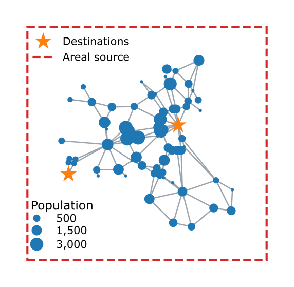
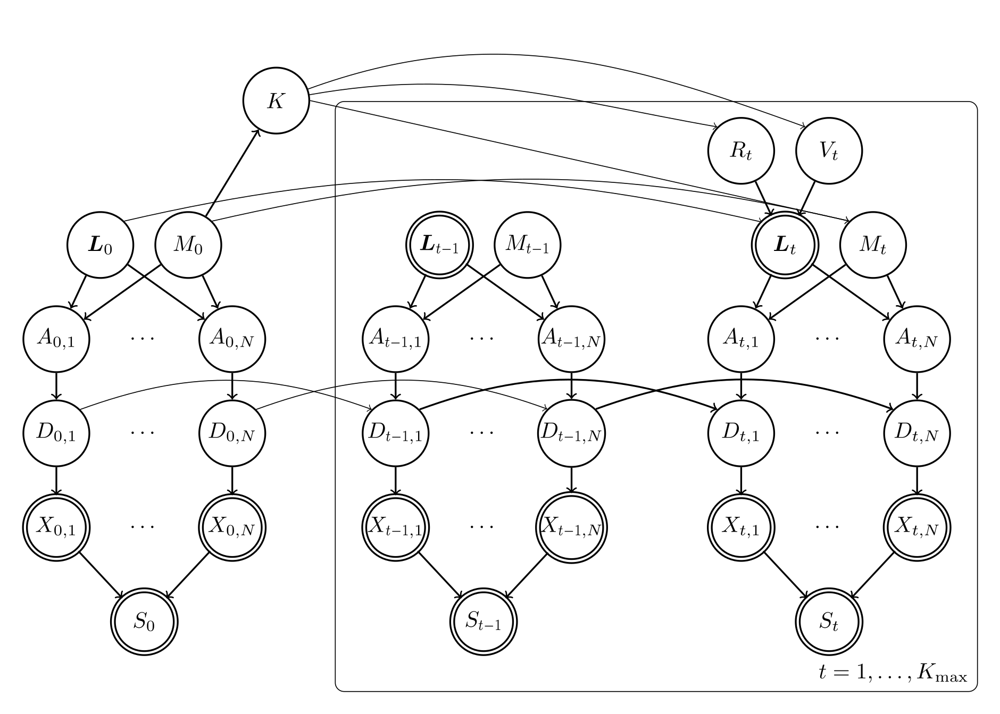
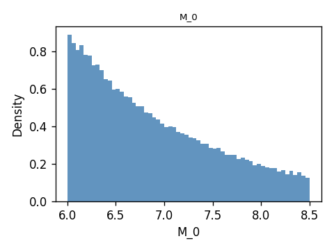
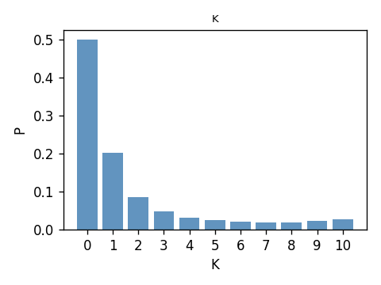
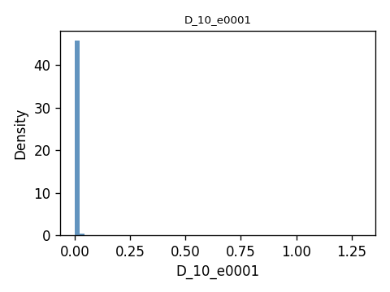
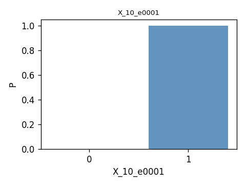
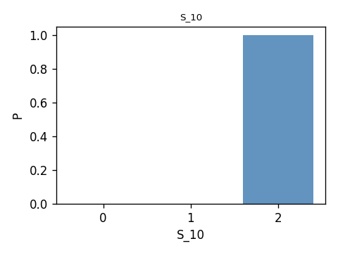
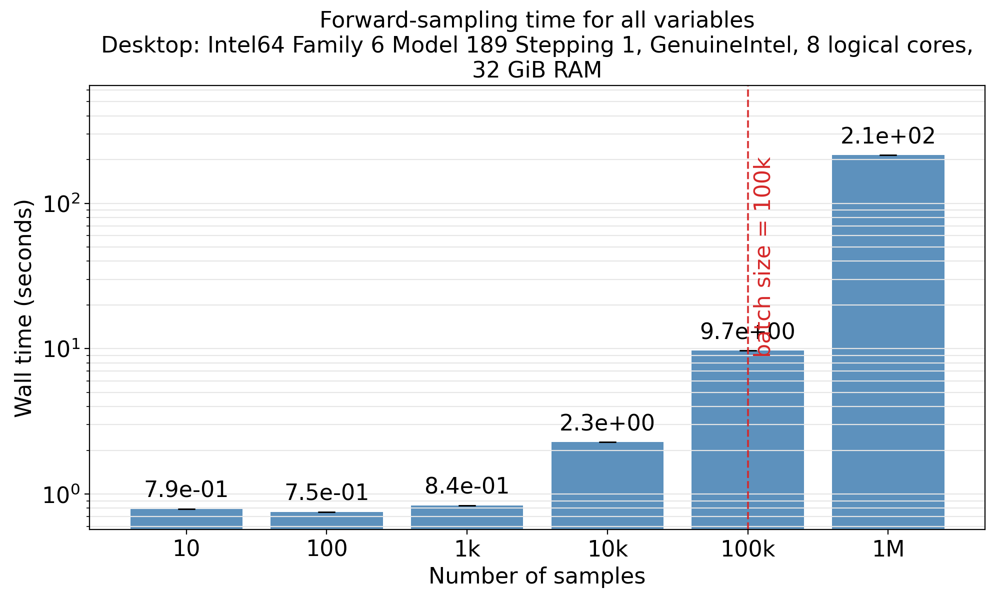

EMA aftershock example
======================

This example builds a Bayesian network for earthquake mainshock-aftershock
analysis on the Eastern Massachusetts highway network. It combines regional
seismicity, edge-level ground motion and damage, binary component survival, and
a system-state classifier based on RSR reference sets.

The full mathematical model is described in
:download:`EMA_aftershock_models.pdf <../../../examples/EMA_aftershock/data/EMA_aftershock_models.pdf>`.
The EMA benchmark network and the hypothetical areal seismic source zone are shown below:

The main BN structure is:

At a high level, the model has one mainshock and up to ``K_max`` aftershock
slots. The mainshock has location ``L_0``, magnitude ``M_0``, and induced edge
variables ``A_{0,n}``, ``D_{0,n}``, and ``X_{0,n}``. The number of aftershocks
``K`` is sampled from ``M_0``. Each aftershock slot ``t`` has distance ``R_t``,
angle ``V_t``, location ``L_t``, magnitude ``M_t``, and the same edge-level
sequence ``A_{t,n}``, ``D_{t,n}``, and ``X_{t,n}``. The system state ``S_t`` is
computed from all component states ``X_{t,n}``.

The example workflow has three analysis steps:

1. Define the BN variables and probability objects.
2. Run unconditional forward sampling and summarise prior behaviour.
3. Estimate ``P(S_t | X_{0,n}=0)`` by modifying a damage node ``P(D_{0,n} | A_{0,n})``.

Step 1: define the model
------------------------

The file ``examples/EMA_aftershock/s01_define_model.py`` assembles the BN.
It provides helper functions to load the highway topology, load RSR reference
sets, create variables, and attach each variable to its probability object.

The main inputs are:

- ``data/nodes.json`` and ``data/edges.json`` for the EMA highway topology.
- ``data/probs_eq.json`` for edge-level single-shock survival/failure data.
- ``rsr_res/refs_up_*.pt`` and ``rsr_res/refs_low_*.pt`` for system-state
  classification.

The key construction functions are:

- ``load_topology()`` reads nodes and edges and computes edge midpoints.
- ``load_rsr_refs()`` loads the reference tensors used by ``S_t``.
- ``define_variables()`` creates names such as ``L_x_0``, ``M_0``, ``K``,
  ``A_0_e0001``, ``D_0_e0001``, ``X_0_e0001``, and ``S_0``.
- ``define_probs()`` creates the corresponding probability objects from
  ``l.py``, ``m.py``, ``k.py``, ``r.py``, ``v.py``, ``a.py``, ``d.py``,
  ``x.py``, and ``s.py``.

The model separates ``L_x`` and ``L_y`` into different variables because the
inference engine expects each probability object to own a unique child
variable name. Mainshock location coordinates are independent uniforms, while
aftershock coordinates are deterministic functions of ``L_0``, ``R_t``, and
``V_t``.

.. literalinclude:: ../../../examples/EMA_aftershock/s01_define_model.py
   :language: python
   :linenos:

Inspecting and checking the model
^^^^^^^^^^^^^^^^^^^^^^^^^^^^^^^^^

Every probability class of this example inherits
:class:`tbnpy.Probability <tbnpy.probability.Probability>` and says what its
distribution is in a ``form()`` method, so a variable or a probability object prints
as one line. With ``K_max = 2``, the model has 1,178 of each; running
``python s01_define_model.py`` prints the mainshock and the first aftershock slot for
edge ``e0001``:

.. code-block:: text

   Variable(name='L_x_0', values=(-inf, inf))
   Variable(name='M_0', values=(-inf, inf))
   Variable(name='K', values=[0, 1, 2])
   Variable(name='X_0_e0001', values=[0, 1])
   Variable(name='S_0', values=[0, 1, 2])
   ...

.. code-block:: text

   L_x_0      L0(P(L_x_0): uniform(low=-15.4647, high=92.7881))
   L_y_0      L0(P(L_y_0): uniform(low=-15.088, high=90.528))
   M_0        M0(P(M_0): truncated exponential(rate=0.76) on [6, 8.5])
   K          K(P(K | M_0): truncated Poisson on 0..2, mean by modified Omori from M_0 (T=7, c=0.05, p=1.08, a=-1.67, b=0.91))
   A_0_e0001  A(P(A_0_e0001 | M_0, L_x_0, L_y_0): lognormal(loc=Campbell-1997 mean of M_0 and the distance from (L_x_0, L_y_0) to (56.8678, 73.0335), scale=0.52); 0 if M_0 = 0)
   D_0_e0001  D0(P(D_0_e0001 | A_0_e0001): lognormal(loc=-1.91 + 2.51 ln A_0_e0001, scale=0.7))
   X_0_e0001  X(P(X_0_e0001 | D_0_e0001): X_0_e0001 = 1 if D_0_e0001 < 0.4, else 0)
   S_0        S(P(S_0 | X_0_e0001, X_0_e0002, X_0_e0003, ..., X_0_e0129 (129)): system state 0..2 from RSR rules over 129 edges; unclassified samples get state -1)
   R_1        R(P(R_1 | K): density r^-1.35 on [1, 50] if K >= 1, else 0)
   V_1        V(P(V_1 | K): uniform(low=0, high=2 pi) if K >= 1, else 0)
   L_x_1      Lt(P(L_x_1 | L_x_0, R_1, V_1): L_x_1 = L_x_0 + R_1 cos(V_1))
   L_y_1      Lt(P(L_y_1 | L_y_0, R_1, V_1): L_y_1 = L_y_0 + R_1 sin(V_1))
   M_1        Mt(P(M_1 | M_0, K): truncated exponential(rate=0.76) on [4.5, M_0 - 1.2] if K >= 1, else 0)
   A_1_e0001  A(P(A_1_e0001 | M_1, L_x_1, L_y_1): lognormal(loc=Campbell-1997 mean of M_1 and the distance from (L_x_1, L_y_1) to (56.8678, 73.0335), scale=0.52); 0 if M_1 = 0)
   D_1_e0001  Dt(P(D_1_e0001 | A_1_e0001, D_0_e0001): lognormal(loc=-1.65 + 0.71 ln A_1_e0001 + 0.19 ln D_0_e0001 - 0.33 ln A_1_e0001 ln D_0_e0001, scale=0.68) truncated below at D_0_e0001; D_0_e0001 if A_1_e0001 = 0)
   X_1_e0001  X(P(X_1_e0001 | D_1_e0001): X_1_e0001 = 1 if D_1_e0001 < 0.4, else 0)
   S_1        S(P(S_1 | X_1_e0001, X_1_e0002, X_1_e0003, ..., X_1_e0129 (129)): system state 0..2 from RSR rules over 129 edges; unclassified samples get state -1)

``print`` gives one object at length. For the system state, the list of 129 parents is
shortened, and the class adds how many RSR reference sets each level has:

.. code-block:: text

   P(S_1 | X_1_e0001, X_1_e0002, X_1_e0003, ..., X_1_e0129 (129))  [S]
     form    system state 0..2 from RSR rules over 129 edges; unclassified samples get state -1
     child   S_1        discrete, 3 states: 0, 1, 2
     parent  X_1_e0001  discrete, 2 states: 0, 1
     parent  X_1_e0002  discrete, 2 states: 0, 1
     ...
     parent  X_1_e0008  discrete, 2 states: 0, 1
     parent  ... 120 more (129 parents in all)
     parent  X_1_e0129  discrete, 2 states: 0, 1
     rules for S >= 1 vs S <= 0: 324 upper, 15 lower reference sets
     rules for S >= 2 vs S <= 1: 530 upper, 82 lower reference sets

Last, :func:`tbnpy.check_model <tbnpy.probability.check_model>` samples a few rows
through all 1,178 objects and confirms that each keeps tbnpy's protocol:

.. code-block:: text

   Model check: 1178 probability objects, 1178 variables, 8 sampled rows: no problems found

The check earned its place on this model. It found that the aftershock damage nodes
``D_t`` returned a log density of ``+inf`` for two thirds of active aftershock rows:
when the truncation bound :math:`\ln D_{t-1}` lay more than about 14 standard
deviations above the mean, ``erfc`` underflowed to zero in single precision. Forward
samples were unaffected, but likelihood weighting and MCMC on those nodes were not.
``d.py`` now uses ``torch.special.log_ndtr``, which stays finite in the tail.

Step 2: forward inference
-------------------------

The file ``examples/EMA_aftershock/s02_forward_inference.py`` performs prior
forward inference with no evidence. It builds the full BN using
``s01_define_model.py`` and samples every variable:

.. code-block:: python

   filled = inference.sample(
       probs=probs,
       query_nodes=query_nodes,
       n_sample=n_sample,
       batch_size=50_000,
   )

The ``batch_size`` argument controls how many samples are generated at once, so that a large number of samples can be generated without running out of memory.

The script writes two kinds of output:

- ``results/forward_stats_Kmax{K}_maxst{M}_n{N}.csv`` with long-form summary
  statistics.
- ``results/histograms/Kmax{K}_maxst{M}_n{N}/`` with one histogram PNG per
  variable.

Representative prior histograms are shown below.

Run the script from the example directory:

.. code-block:: bash

   cd examples/EMA_aftershock
   python s02_forward_inference.py

Step 3: conditioning on component failure
-----------------------------------------

The file ``examples/EMA_aftershock/s03_cal_s_x0.py`` estimates

.. math::

   P(S_t \mid X_{0,n}=0)

for each edge ``n`` and each time slice ``t``. Here ``X_{0,n}=1`` means that
edge ``n`` survives the mainshock, so ``X_{0,n}=0`` means the edge fails.

The conditioning is implemented by a small model surgery. Since ``X_{0,n}``
is a deterministic threshold of ``D_{0,n}``, the script replaces the original
probability object for ``D_{0,n}`` with ``DeltaD``:

.. code-block:: python

   probs_mod[f"D_0_{edge_id}"] = DeltaD(
       childs=[varis[f"D_0_{edge_id}"]],
       parents=orig.parents,
       value=1.0,
       device=device,
   )

This sets ``D_{0,n}=1.0`` regardless of the values of its parent variables.
Because ``1.0`` is above the damage threshold used by ``X_{0,n}``, the
modified BN represents the event ``X_{0,n}=0``. Forward sampling under this
modified model therefore gives Monte Carlo samples from
``P(S_t | X_{0,n}=0)``:

.. code-block:: python

   marg = estimate_S_marginals(
            probs_mod,
            varis,
            K_max,
            n_sample,
            max_st=max_st,
            batch_size=batch_size,
        )

where ``estimate_S_marginals()`` is a helper function that runs forward sampling using ``inference.sample`` with the updated probabilities ``probs_mod``.

The surrogate node keeps the original parents so that ancestor ordering and
downstream dependencies remain valid, but its ``sample`` and ``log_prob``
methods ignore those parent values.

The output is a long-form CSV:

``results/S_given_X0_zero_Kmax{K}_maxst{M}_n{N}.csv``

with columns:

- ``edge``
- ``t``
- ``S``
- ``P(S_t=S | X_0_n=0)``
- ``cov``, the coefficient of variation of the empirical probability estimate

Run the script from the example directory:

.. code-block:: bash

   cd examples/EMA_aftershock
   python s03_cal_s_x0.py

The ``__main__`` block can be adjusted for larger or smaller sample budgets,
GPU use, and a subset of target edges.

Computational cost scaling
--------------------------

The file ``examples/EMA_aftershock/s04_eval_performance.py`` benchmarks how
the wall-clock cost of forward sampling changes as the number of Monte Carlo
samples increases. By default, it samples all variables in the EMA BN, matching
the forward-sampling setup used in ``s02_forward_inference.py``.

The cost generally increases with the number of samples, but the scaling
benefit from vectorisation diminishes as the requested sample count reaches the
internal ``batch_size``. Beyond that point, the sampler splits the work into
multiple batches, which adds overhead and can make the computation scale less
smoothly.

Run the benchmark from the example directory:

.. code-block:: bash

   cd examples/EMA_aftershock
   python s04_eval_performance.py
