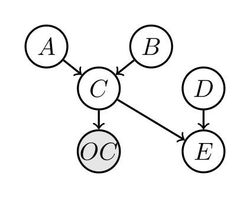

ABCDE example
==============

This example demonstrates how **TBN** performs inference on a Bayesian
network that combines **discrete and continuous variables**, using
tensorised Monte Carlo sampling and adaptive MCMC.

The example is intentionally minimal, but it exercises the full
workflow: model definition, evidence conditioning, scalable inference,
and posterior analysis.

Model structure
---------------

The Bayesian network consists of six variables:

- **A**: discrete, two states
- **B**: discrete, three states
- **C**: continuous, conditioned on *(A, B)*
- **OC**: continuous observation of *C*
- **D**: binary
- **E**: continuous, deterministic function of *(C, D)*

The BN graph is:

**OC** is shaded as an observed variable.

Task
----

Given multiple noisy observations of **OC**, the task is to infer the
posterior distributions of **A**, **B**, and **C**,
i.e. :math:`p(A, B, C \mid OC=\text{evidence})`.

Step 0: Define custom variables and probability distributions
^^^^^^^^^^^^^^^^^^^^^^^^^^^^^^^^^^^^^^^^^^^^^^^^^^^^^^^^^^^^^

**A**, **B**, and **D** are discrete, tractable (i.e. small state-space) variables,
so they use built-in CPT classes.

**C**, **OC**, and **E** are continuous (or non-tabular) variables, requiring custom
probability models:

- **C | A, B**: Gaussian distribution with mean and variance depending on the
  discrete parents *(A, B)*:

  .. literalinclude:: ../../../examples/ABCDE/c.py
     :language: python
     :linenos:

- **OC | C**: Noisy observation model with Gaussian noise:

  .. literalinclude:: ../../../examples/ABCDE/oc.py
     :language: python
     :linenos:

- **E | C, D**: Deterministic relation defined by a function:

  .. literalinclude:: ../../../examples/ABCDE/e.py
     :language: python
     :linenos:

Important notes
^^^^^^^^^^^^^^^

A custom probability model class should include (at minimum) the following methods:

1. ``__init__`` defines core properties such as ``childs``, ``parents``, and ``device``
   (``cpu`` or ``gpu``). Additional properties may be added as needed.

2. ``sample`` generates samples of child variables conditioned on given samples of
   the parent nodes.

   - Inputs: ``self`` and ``Cs_pars``, where ``Cs_pars`` is a tensor of shape
     ``(num_samples, num_parents)`` storing realisations of the parent variables.
   - Returns:
     - **(recommended)** a tensor of child samples of shape ``(num_samples, num_childs)``
     - a tensor of log-probabilities of shape ``(num_samples,)`` for the generated samples

3. ``log_prob`` computes the log-probability of given samples.

   - Inputs: ``self`` and ``Cs``, where ``Cs`` is a tensor of shape
     ``(num_samples, num_childs + num_parents)`` storing realisations of both
     child (first) and parent (second) variables.
   - Returns: a tensor of shape ``(num_samples,)`` storing log-probabilities.

All methods should be compatible with both CPU and GPU tensors and should use
PyTorch tensor operations for efficiency.

The three classes inherit :class:`tbnpy.Probability <tbnpy.probability.Probability>`.
This is optional (tbnpy accepts any class with the attributes and methods above), but
it makes each object print as the distribution it defines. Calling
``super().__init__(childs, parents, device)`` sets ``childs``, ``parents`` and ``device``,
and each class says what its distribution is in a one-line ``form()`` method.

Step 1: defining variables and probability models
-------------------------------------------------

The file ``s1_define_model.py`` defines:

1. Variables (discrete vs. continuous)
2. Conditional probability objects for each node

In particular:

- **P(A)** and **P(B)** are defined using categorical CPTs
- **P(C | A, B)** follows a Gaussian model
- **P(OC | C)** is a noisy observation model
- **P(E | C, D)** is deterministic

This separation between variables and probability objects allows
TBN to mix arbitrary discrete, continuous, and deterministic relations
within a single network.

The full model definition is shown below.

.. literalinclude:: ../../../examples/ABCDE/s1_define_model.py
   :language: python
   :linenos:

Inspecting and checking the model
^^^^^^^^^^^^^^^^^^^^^^^^^^^^^^^^^

Running ``python examples/ABCDE/s1_define_model.py`` prints what was defined. Each
variable and each probability object reads as one line:

.. code-block:: text

   {'A': Variable(name='A', values=[-0.3, 0.3]), 'B': Variable(name='B', values=[-0.2, 0.0, 0.2]),
    'C': Variable(name='C', values=(-inf, inf)), 'OC': Variable(name='OC', values=(-inf, inf)),
    'D': Variable(name='D', values=[0, 1]), 'E': Variable(name='E', values=(-inf, inf))}
   {'A': Cpt(P(A): table of 2 rows), 'B': Cpt(P(B): table of 3 rows),
    'C': C(P(C | A, B): normal(loc=A + B, scale=0.6)), 'OC': OC(P(OC | C): normal(loc=C, scale=0.5)),
    'D': Cpt(P(D): table of 2 rows), 'E': E(P(E | C, D): deterministic: E = C if D == 0, else 0)}

``print`` gives one object at length, with each variable's domain and, for a
:class:`~tbnpy.cpt.Cpt`, its table with state labels:

.. code-block:: text

   P(C | A, B)  [C]
     form    normal(loc=A + B, scale=0.6)
     child   C  continuous (-inf, inf)
     parent  A  discrete, 2 states: -0.3, 0.3
     parent  B  discrete, 3 states: -0.2, 0.0, 0.2
   P(B)  [Cpt]
     form    table of 3 rows
     child   B  discrete, 3 states: -0.2, 0.0, 0.2
     B     p
     -0.2  0.3
     0.0   0.4
     0.2   0.3

Last, :func:`tbnpy.check_model <tbnpy.probability.check_model>` samples a few rows
through the whole model and confirms that every object keeps tbnpy's protocol: the
right shapes, values inside each variable's domain, and a ``log_prob`` that agrees with
``sample``. Had ``C.log_prob`` read its columns in the wrong order, it would say so
here rather than through a wrong posterior later:

.. code-block:: text

   Model check: 6 probability objects, 6 variables, 8 sampled rows: no problems found

The same model as a spec
^^^^^^^^^^^^^^^^^^^^^^^^

The model can also be written as data. ``abcde.tbn.json`` describes the same six
variables and nodes, with **C** and **OC** as ``distribution`` nodes, **E** as an
``equation`` node, and **A**, **B** and **D** as ``discrete_cpt`` nodes
(see :mod:`tbnpy.spec`):

.. literalinclude:: ../../../examples/ABCDE/abcde.tbn.json
   :language: json

``s1_define_model_from_spec.py`` compiles it with :func:`tbnpy.compile.compile_file`,
prints the compiled nodes, checks them, and confirms that they give the same numbers
as the hand-written classes. Everything that follows runs on either model.

.. literalinclude:: ../../../examples/ABCDE/s1_define_model_from_spec.py
   :language: python
   :linenos:

Its output begins:

.. code-block:: text

   {'A': Cpt(P(A): table of 2 rows), 'B': Cpt(P(B): table of 3 rows),
    'C': DistributionSpecNode(P(C | A, B): normal(loc=A + B, scale=0.6)),
    'OC': DistributionSpecNode(P(OC | C): normal(loc=C, scale=0.5)),
    'D': Cpt(P(D): table of 2 rows), 'E': EquationSpecNode(P(E | C, D): E = If(D == 0, C, 0))}

Step 2: evidence and scalable inference
---------------------------------------

The file ``s2_run_sample.py`` performs inference conditioned on evidence
for **OC**.

Key steps are:

1. **Prior sampling — forward inference**

   Forward inference (i.e. inference without any evidence) can be
   performed using ``inference.sample_evidence`` with an empty evidence
   dictionary. See the function ``sample_prior``.

2. **Posterior inference — MCMC sampling**

   a. *Evidence definition.*
      Multiple observations of **OC** are generated and stored in a
      tabular format, allowing batched conditioning.

   b. *Forward sampling initialisation.*
      Initial MCMC chains are generated using forward sampling from the
      prior, improving stability and convergence.

   c. *Adaptive MCMC.*
      An adaptive Metropolis–Hastings sampler is used to infer the
      posterior of *(A, B, C)* given the evidence, i.e.
      **P(A, B, C | OC=oc)**.

TBN evaluates many Monte Carlo samples simultaneously by reformulating
inference computations as tensor operations. This enables efficient
scaling across chains, evidence rows, and iterations.

.. literalinclude:: ../../../examples/ABCDE/s2_run_sample.py
   :language: python

Prior vs posterior distributions
--------------------------------

The prior and posterior distributions for variables **A**, **B**, and
**C** illustrate how evidence propagates through both discrete and
continuous parts of the network.

- **A**: posterior probability shifts relative to the prior
- **B**: moderate posterior update through indirect influence
- **C**: posterior density becomes narrower

This demonstrates how noisy observations constrain latent variables.