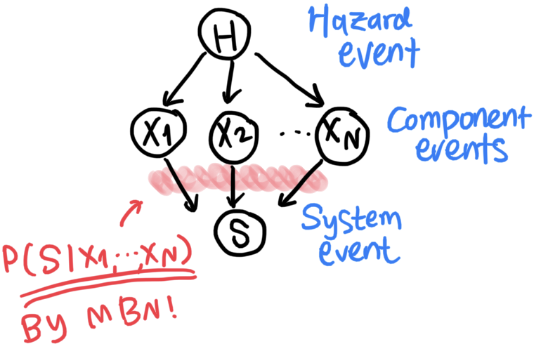

.. tbnpy documentation master file, created by
   sphinx-quickstart on Mon Jan  5 15:51:12 2026.
   You can adapt this file completely to your liking, but it should at least
   contain the root `toctree` directive.

tbnpy documentation
===================

**TBNpy** is a Python toolkit for tensor-based Bayesian network (TBN).
TBN tensorises the quantification and inferences of Bayesian networks (BNs) and thereby addresses BNs' scalability issues when applied to **large-scale systems** (i.e. high-dimensional system events).

This is the documentation of tbnpy |release|.

What's new
----------

In 0.3.2:

- **Specs describe only the model.** The optional ``analysis`` section (intended queries
  and observed nodes) is gone: a Bayesian network answers any query within its scope.
  Older files that have one still load.

In 0.3.1:

- **Joint fields in specs.** A ``custom`` spec node may own several variables (``childs``),
  so a field drawn jointly over many sites is one node, as it is one probability object.
- **Reproducible seeds.** A seeded run gives the same samples in every process; before,
  the sampling order depended on Python's per-process string hashing.

In 0.3.0:

- **Readable models.** A variable or probability object prints as one line, such as
  ``C(P(C | A, B): normal(loc=A + B, scale=0.6))``, and ``print`` shows each variable's
  domain. Custom classes get this by inheriting the optional base class
  :class:`tbnpy.Probability <tbnpy.probability.Probability>`.
- **A model check.** :func:`tbnpy.check_model <tbnpy.probability.check_model>` samples a few
  rows through a whole model and reports every object that breaks tbnpy's protocol.
- **Models as data, documented.** Specs (:mod:`tbnpy.spec`, :mod:`tbnpy.compile`) and
  diagnostics (:mod:`tbnpy.diagnostics`) now have API pages, and the ABCDE example comes
  as a spec too.

See :doc:`changelog` for the full list.

Background
----------

**Bayesian network** is a probabilistic graphical model that can map the causality between variables, for example:

   An illustration of a Bayesian network.

For further reading:

* For a brief introduction of Bayesian network in the context of system reliability, refer to `this blog article <https://jieunbyun.github.io/categories/bn/>`_.
* A formal publication is under preparation.

.. toctree::
   :maxdepth: 2
   :caption: Contents:

   getting_started/overview
   getting_started/repo_structure
   api/modules
   examples/EMA_aftershock
   examples/abcde_example
   changelog

